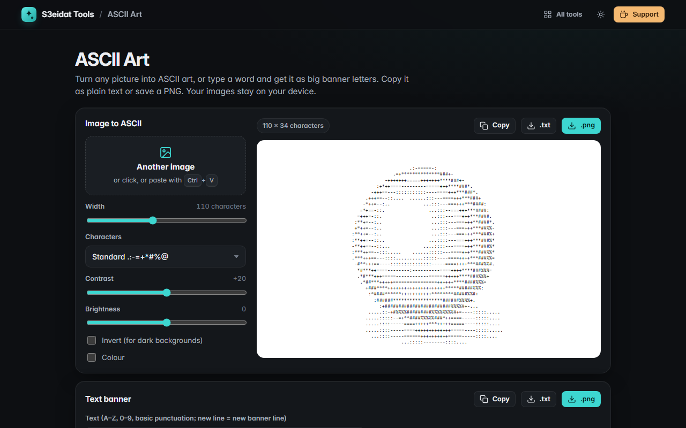

# ASCII Art

> Turn images into ASCII art and text into big banner letters. Free, private, and it runs entirely in your browser.

### ▶ [Open ASCII Art](https://s3eidat.github.io/ascii-art/)



## Features

**Image to ASCII**
- Drop, choose or paste (Ctrl+V) any image
- **Width** from 20 to 240 characters; height follows the image, corrected for tall monospace characters
- **Character sets**: standard, detailed (70 levels), blocks `░▒▓█`, simple, binary, or your own
- **Contrast** and **brightness**, **invert** for dark backgrounds
- **Colour** mode: each character takes the colour of its area (in the preview and the PNG; copied text stays plain)
- Copy as text, download **.txt** or **.png**

**Text banner**
- Type a word (A–Z, 0–9 and common punctuation; one banner per line) and get big letters
- Six built-in fonts, drawn from two pixel fonts authored for this tool: Block, Shadow, Character (any fill
  character you like), Compact (half blocks), Small and Tiny
- Copy, download .txt or .png

## Privacy

Your images never leave your device; everything is computed in this tab. There is no server, no account, no analytics.
The page ships with a strict Content-Security-Policy (`connect-src 'self'`), so the browser itself blocks any attempt to
send data anywhere. Only your settings are remembered in this browser.

## Run it yourself

It's plain HTML, CSS and JavaScript with no build step:

```bash
git clone https://github.com/s3eidat/ascii-art
cd ascii-art
python -m http.server 8000
```

Then open http://localhost:8000.

## Support

If this saved you time, **[buy me a coffee ☕](https://s3eidat.github.io/coffee/)**. It keeps every tool free.

---

Part of **[S3eidat Tools](https://s3eidat.github.io/)**: 100+ free, private tools that run in your browser. MIT licensed.
